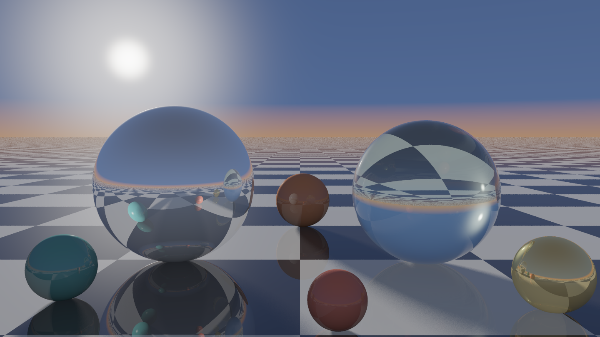
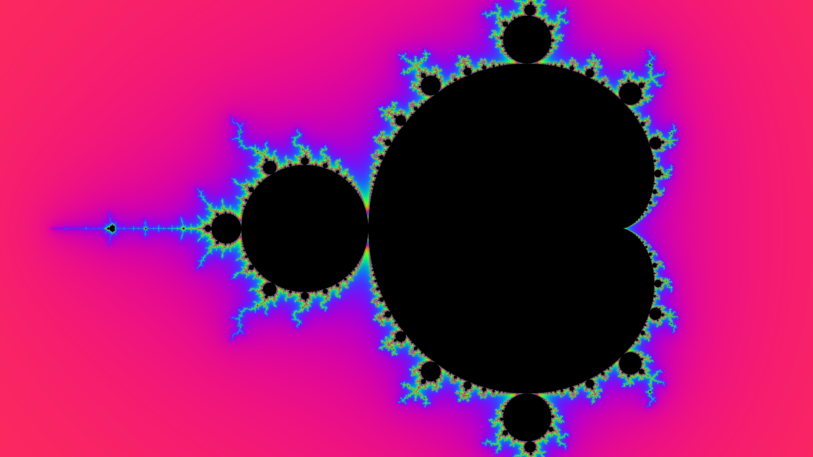
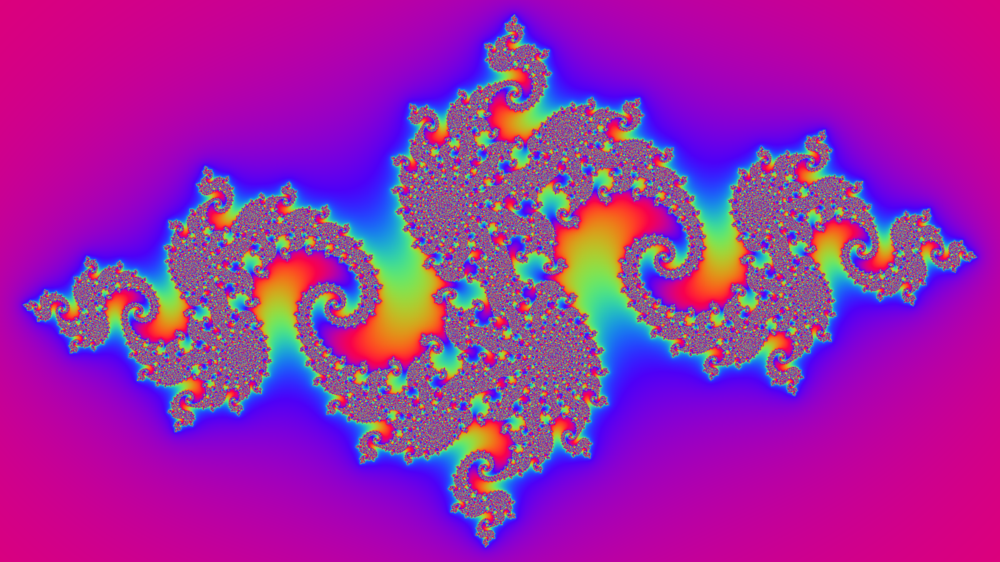
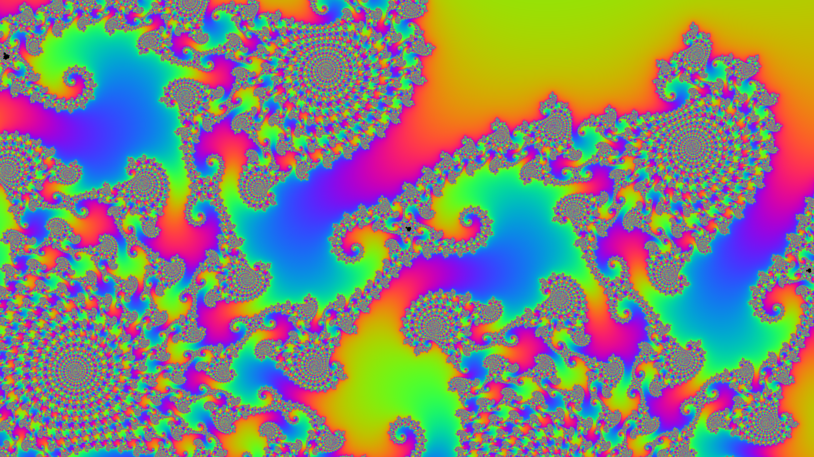
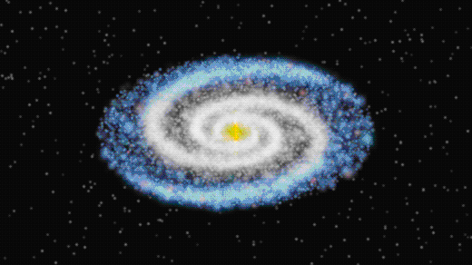
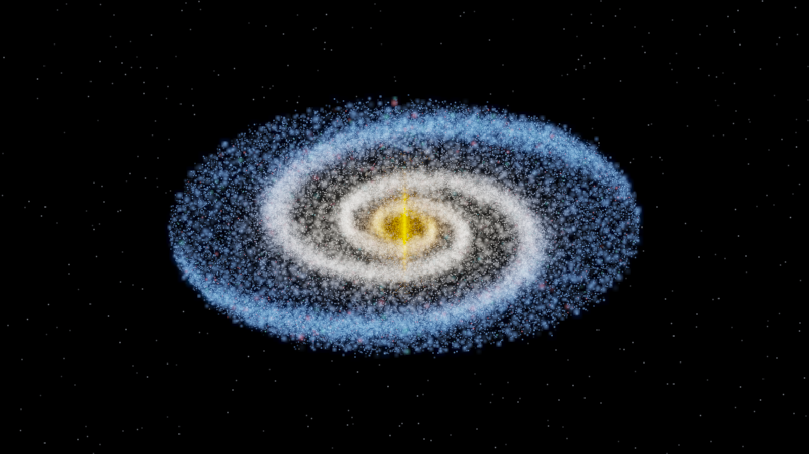
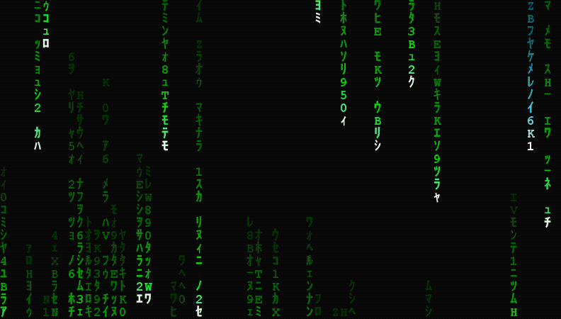
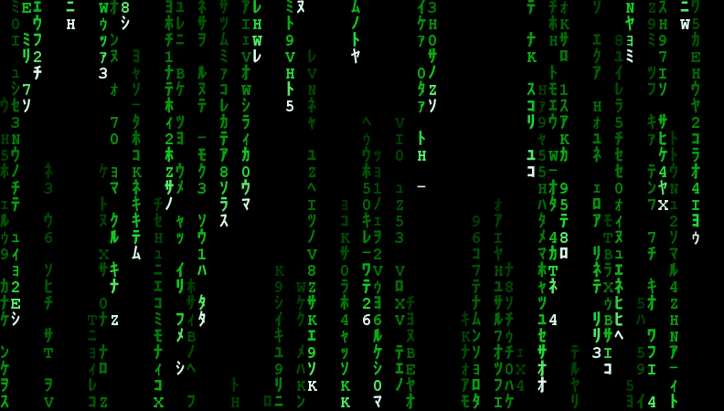

<div align="center">

# 🍬 Java Eye Candy

**五个用纯 Java 手搓的「哇塞」小玩意 —— 零依赖、零构建、一行命令跑起来**

[](https://openjdk.org/)
[](.)
[](https://github.com/yr6354/java-eye-candy/actions/workflows/build.yml)
[](LICENSE)



*上面这张图不是照片，也不是渲染农场跑出来的 —— 是 430 行纯 Java 光线追踪代码，在 12 核笔记本上算了 70 秒。*

</div>

---

## 这是什么

一个「Java 也可以很好看」的演示合集。里面没有 Spring、没有 Maven 依赖、没有一行第三方库，
只有 `java.desktop` 这个 JDK 自带的模块，和一堆数学。

每个小玩意都是**单文件可运行**的：

```bash
git clone https://github.com/yr6354/java-eye-candy.git
cd java-eye-candy
java src/candy/Fractal.java          # 就是这么简单，没有编译、没有安装
```

> **一键运行需要 JDK 22 或更新版本** —— 靠的是 JDK 22 引入的多文件源码启动。
> 源码本身兼容 JDK 17+，老版本 JDK 就先编译再运行：
>
> ```bash
> javac -encoding UTF-8 -d out src/candy/*.java && java -cp out candy.Fractal
> ```
>
> 作者在 JDK 26 上开发，CI 里用 `--release 17` 编译 + JDK 25 跑冒烟测试。

## 五个小玩意

| # | 名字 | 是什么 | 一眼记住的点 |
|---|------|--------|--------------|
| 1 | 🎨 **FractalForge** | 分形渲染器：Mandelbrot / Julia / Burning Ship | 平滑着色 + 余弦调色板 + 超采样，1600×900 只要 1 秒 |
| 2 | 🔮 **Glass & Chrome** | 从零手写的光线追踪器 | 镜面反射、玻璃折射、菲涅尔、面光源软阴影 |
| 3 | 🌌 **GalaxySim** | 旋涡星系粒子模拟 | 对数螺线密度波 + 加性高斯光斑 + 泛光，导出循环 GIF |
| 4 | 🟩 **MatrixRain** | 黑客帝国数字雨 | 终端 ANSI 真彩色直播，也能录成 GIF |
| 5 | 🔤 **AsciiView** | 图片转终端字符画 | 24 位真彩色 ANSI，任何照片都能贴进终端 |

---

## 1. 🎨 FractalForge —— 分形渲染器

逃逸时间算法 + 平滑着色（smooth iteration count）+ Inigo Quilez 风格的余弦调色板，
多线程按行并行，输出直接就是 PNG。



```bash
# 经典全图（1920x1080，约 1.2 秒）
java src/candy/Fractal.java

# 深潜到「海马谷」，需要更多迭代次数
java src/candy/Fractal.java --cx -0.7436438870371587 --cy 0.13182590420531198 \
     --zoom 6000 --iter 1600 -w 1600 -h 900 --palette rainbow --out docs/fractal-zoom.png

# Julia 集：换个种子就是另一个世界
java src/candy/Fractal.java --type julia --julia-cx -0.8 --julia-cy 0.156 --palette neon

# 燃烧的船
java src/candy/Fractal.java --type ship --cx -0.5 --cy -0.55 --palette ember
```

<div align="center">


</div>

常用参数：

| 参数 | 说明 | 默认 |
|------|------|------|
| `--type` | `mandelbrot` / `julia` / `ship` | mandelbrot |
| `--zoom` `--cx` `--cy` | 视口放大倍数与中心点 | 1 / -0.6 / 0 |
| `--iter` | 最大迭代次数 | 900 |
| `--ss` | 超采样倍数（1–4），抗锯齿 | 2 |
| `--palette` | `rainbow` / `ice` / `ember` / `neon` / `mono` | ice |
| `--scale` `--shift` | 色带长度与偏移 | 48 / 0 |

---

## 2. 🔮 Glass & Chrome —— 手写光线追踪器

光线的世界里没有"渲染器"，只有解方程。这个文件从零实现了几何求交、
冯氏高光、镜面反射、介质折射（含全内反射与 Schlick 菲涅尔）、
软阴影（对面光源采样）和 filmic 色调映射。

```bash
java src/candy/RayTracer.java                      # 1440x810，3x3 抗锯齿，约 70 秒
java src/candy/RayTracer.java -w 640 -h 360 --aa 2 # 快速预览
```

<div align="center">

</div>

光线追踪的取舍都写在这个文件里了，几个值得一看的地方：

- `radiance()` 是全部核心：漫反射 + 高光 + 天空环境光 + 菲涅尔反射 + 折射，递归 6 层。
- 玻璃球用「进入/离开介质」的显式判断，折射光线从原点沿法线偏移，避免自交。
- 软阴影对太阳圆盘采样 14 次，阴影边缘自然过渡 —— 采样数就是 `--shadow`。
- `docs/raytracer.png` 那张图用的是 1440×810、3×3 超采样、每像素约 30 条光线。

---

## 3. 🌌 GalaxySim —— 旋涡星系

<div align="center">

</div>

三万多个粒子，各自沿星系旋转曲线 `v(r) = v₀r/√(r²+rc²)` 运动 —— 内圈快、外圈慢，
所以你会亲眼看着旋臂在几秒内慢慢缠绕起来（这就是天文学里著名的「缠绕难题」）。
旋臂本身是用**对数螺线**撒点的密度波，渲染方式是加性高斯光斑 + 两级模糊泛光 + 色调映射。

```bash
java src/candy/GalaxySim.java                        # 96 帧循环 GIF，约 6 秒
java src/candy/GalaxySim.java --still docs/galaxy.png --still-size 1600
java src/candy/GalaxySim.java --tilt 0 --stars 60000 # 正面俯视，星星加倍
```

<div align="center">

</div>

| 参数 | 说明 | 默认 |
|------|------|------|
| `--stars` | 粒子数量 | 34000 |
| `--frames` `--delay` | 帧数与每帧毫秒 | 96 / 60 |
| `--spin` | 整个循环内转过的角度 | 40° |
| `--tilt` | 盘面倾角，0 为正面对着你 | 58° |

---

## 4. 🟩 MatrixRain —— 数字雨

<div align="center">

</div>

同一套粒子状态机，两个前端：终端里是 ANSI 24 位真彩色实时播放（头部亮白、尾部渐绿、
偶发青色故障列），也可以整段录成 GIF。

```bash
java src/candy/MatrixRain.java                                  # 直接在终端里下 24fps 的雨
java src/candy/MatrixRain.java --density 1.6 --glitch 0.12      # 更密、更有故障感
java src/candy/MatrixRain.java --record docs/matrix.gif         # 录成动图
java src/candy/MatrixRain.java --record out.gif --record-still docs/matrix-still.png   # 顺便存一张整屏壁纸
```

终端尺寸会自动读取 `COLUMNS`/`LINES`（Unix 下再退化为 `stty size`），也可以 `--cols/--rows` 手动指定。
按 <kbd>Ctrl</kbd>+<kbd>C</kbd> 退出，光标和颜色都会被正确还原。

<div align="center">

</div>

---

## 5. 🔤 AsciiView —— 图片转字符画

给它一张图，它还你一屏 ANSI 真彩色字符。

```bash
java src/candy/AsciiView.java docs/raytracer.png --cols 120          # 彩色字符画
java src/candy/AsciiView.java docs/galaxy.png --mono --cols 100      # 纯文本
java src/candy/AsciiView.java docs/raytracer.png --stats             # 顺便统计一下这张图
```

`--stats` 会打印尺寸、平均 RGB、色彩数量、色相分布和一张灰度预览图 ——
在没有图形界面（或者只是懒得开图）的环境里，这是最快的"看图"方式。

---

## 实现上的一些小心思

**没有第三方库，是因为不需要。** JDK 自带的 `java.desktop` 能做不少事：

- **动图导出**：`Gif.java` 直接用 JDK 内置的 GIF 编码器，自己拼 `GraphicControlExtension`
  和 NETSCAPE 循环扩展，配上 6×6×6 web-safe 调色板和 4×4 Bayer 抖动。
  选 216 色而不是写中位切分量化，是因为这几个玩意的画面本来就是荧光/星云色系，
  web-safe 调色板覆盖得很好，而且省掉了几百行量化代码。

- **多文件源码启动**：`java src/candy/Fractal.java` 直接跑，靠的是 JDK 22+ 的多文件源码模式，
  连 `javac` 都不用调。所以每个小玩意都能被单独复制出去当独立文件用。

- **一台笔记本就够**：所有渲染都按行/按粒子并行。上面那张光线追踪图（1440×810、3×3 超采样、
  每像素约 30 条光线）在 12 核上跑了 70 秒，星系动图 6 秒，分形 1 秒。

```
src/candy/
├── Cli.java          60 行命令行解析器，所有程序共用
├── Gif.java          纯 JDK 动图编码 + 调色板 + 抖动
├── Fractal.java      🎨 分形渲染
├── RayTracer.java    🔮 光线追踪
├── GalaxySim.java    🌌 星系模拟
├── MatrixRain.java   🟩 数字雨
└── AsciiView.java    🔤 终端看图 / 图片转字符画
```

`docs/` 里的所有图片都是这些程序自己生成的，仓库里没有任何手绘素材。

---

## English

**Java Eye Candy** — five little programs written in pure JDK Java, no dependencies and
no build step: a fractal renderer, a from-scratch ray tracer (reflections, refraction,
Fresnel, soft shadows), a spinning spiral-galaxy particle simulation that exports looping
GIFs, a terminal digital-rain effect, and an image-to-ANSI-art viewer. Run any of them with
a single command, e.g. `java src/candy/RayTracer.java` (needs JDK 22+ for multi-file
source launching; the sources themselves compile with `--release 17`).

## License

[MIT](LICENSE) —— 拿去用、拿去改、拿去交作业都行。
